

  <a href="https://aelradi.engineer">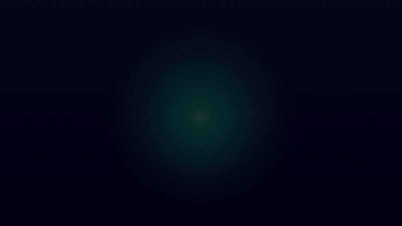</a>

<h1 align="center">aelradi.engineer</h1>

  <strong>The portfolio of Abdalla Elradi — AI &amp; Robotics Engineer · Computer Vision · Autonomous Systems.</strong> 
  A 40-second motion film and a picture tour of the site.

  
  
  
  

---

**[Open the site →](https://aelradi.engineer)** — one page, nine sections: featured projects, AI automation systems, skills, services, a booking calendar, certificates, experience, contact, and an AI assistant that answers for me.

## The film

  

**[▶ Watch the film (MP4, 40 s)](media/portfolio-showcase-720p.mp4)** — the site rises in a laptop, scrolls through its sections, then the project cards, the four AI systems and the phone app. Every cut lands on the beat of an original soundtrack.

## The site in pictures

| | |
|---|---|
| 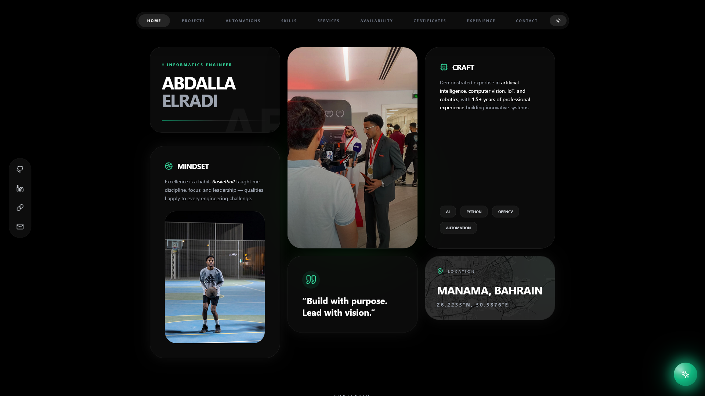 | 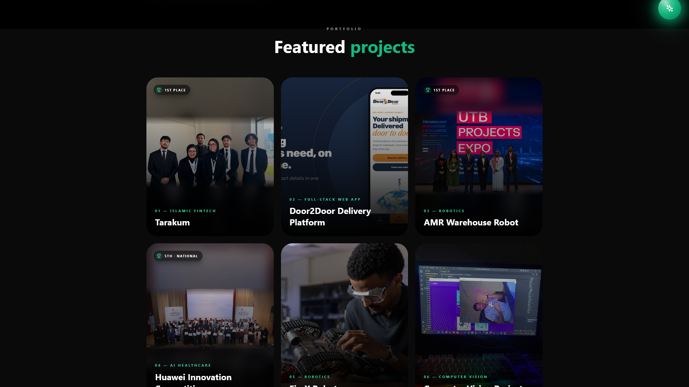 |
| Home | Featured projects |
| 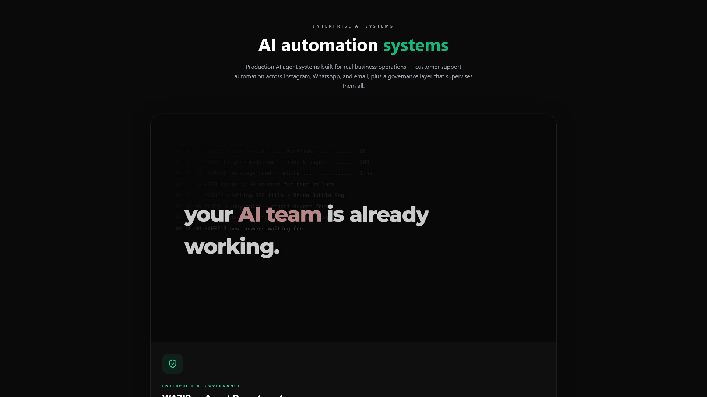 | 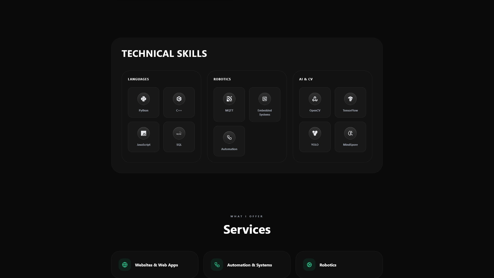 |
| AI automation systems | Technical skills |
| 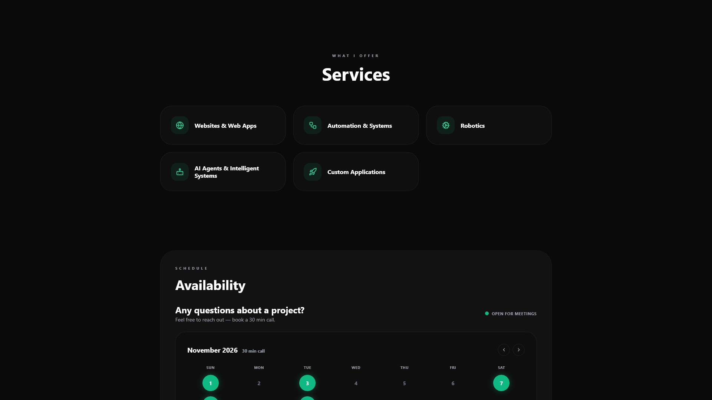 | 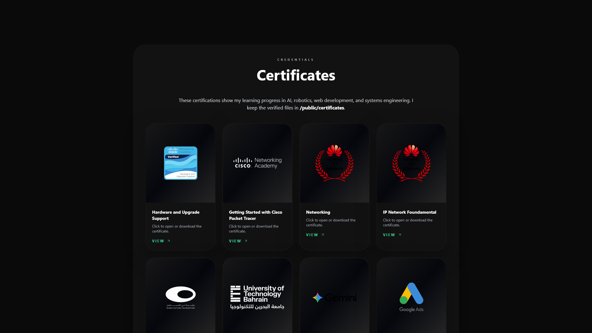 |
| Services | Certificates |
| 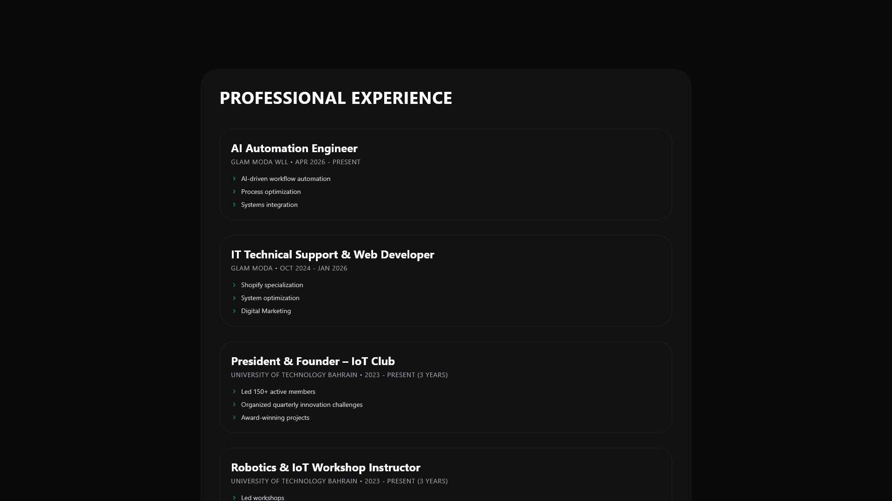 | 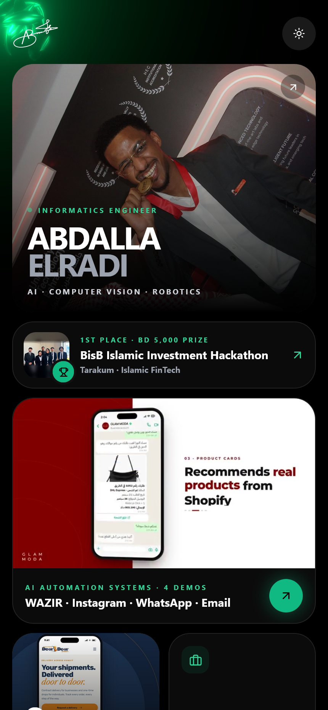 |
| Experience | The phone app |

The whole desktop page in one picture: [media/pictures/09-full-page-desktop.jpg](media/pictures/09-full-page-desktop.jpg) · the whole phone app: [media/pictures/11-phone-full-page.png](media/pictures/11-phone-full-page.png)

## What is on the site

- **Eight featured projects, two first places** — Tarakum (Islamic fintech, 1st place · BD 5,000 prize), Door2Door delivery platform, AMR warehouse robot (1st place), Huawei Innovation Competition (5th, national), FireX robot, computer-vision projects, Sumo X competition, Robonexus.
- **Four live AI systems** — WAZIR, an AI agent department with a kill switch, and three customer-support agents on Instagram, WhatsApp and email.
- **Sixteen certificates**, the technical skills, five services, a booking calendar, and professional experience.

## Film stills

| | | |
|---|---|---|
| 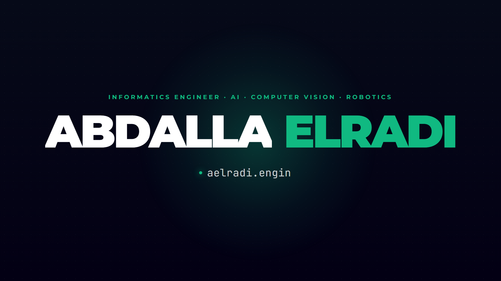 | 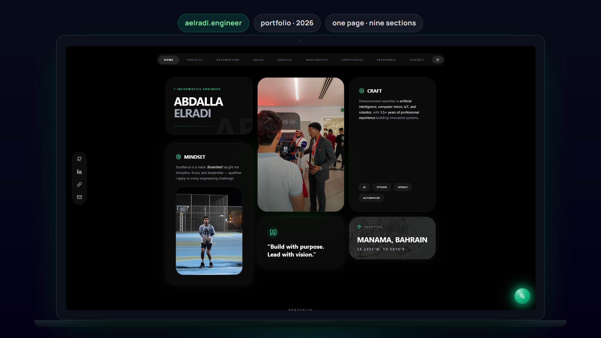 | 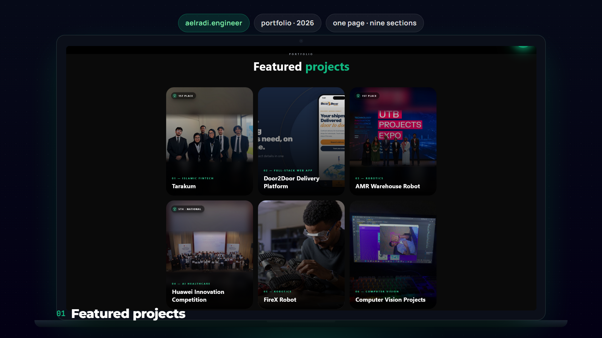 |
| 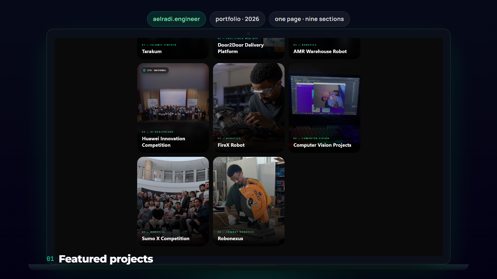 | 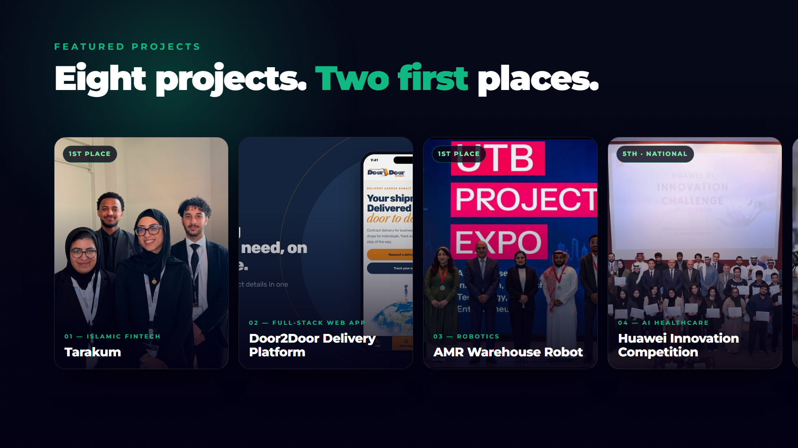 | 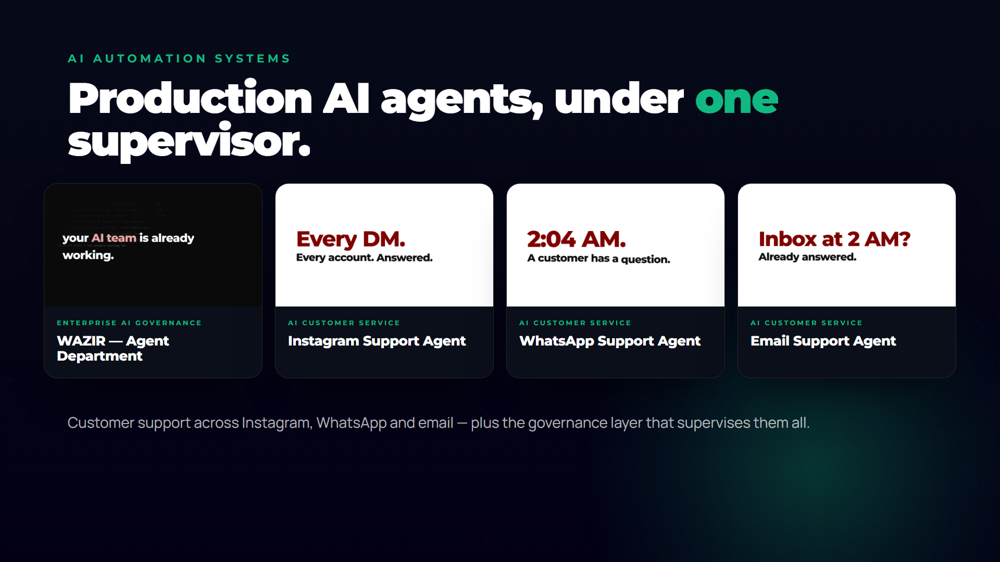 |
| 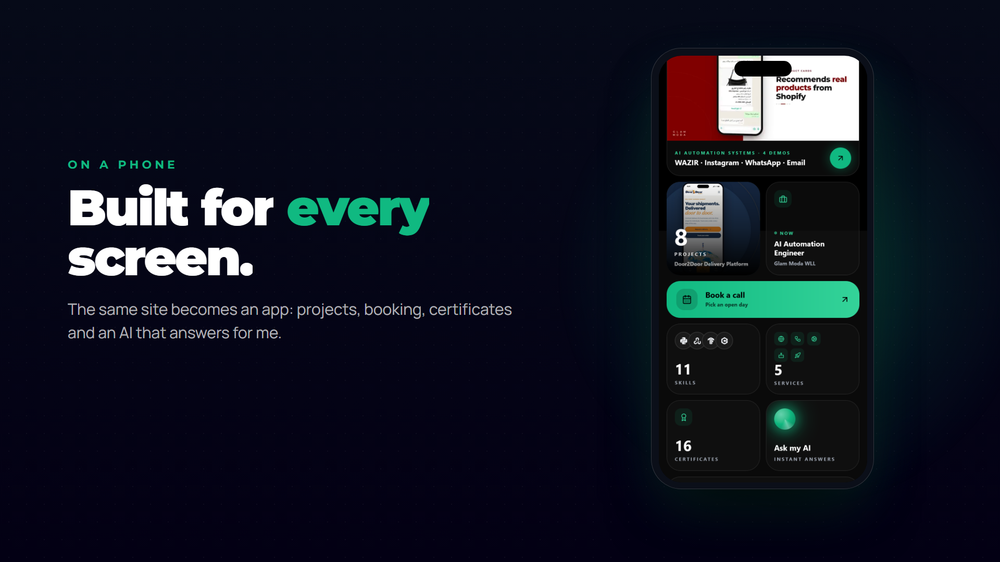 | 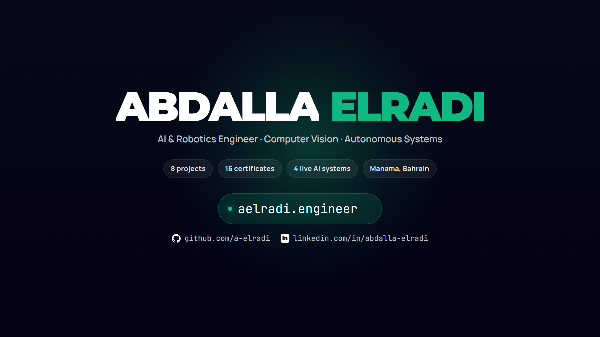 | |

## Links

- Site: [aelradi.engineer](https://aelradi.engineer)
- GitHub: [github.com/a-elradi](https://github.com/a-elradi)
- LinkedIn: [linkedin.com/in/abdalla-elradi](https://www.linkedin.com/in/abdalla-elradi/)

© 2026 Abdalla Elradi. All rights reserved — the film, the pictures and the site they show may not be copied, modified or redistributed.
